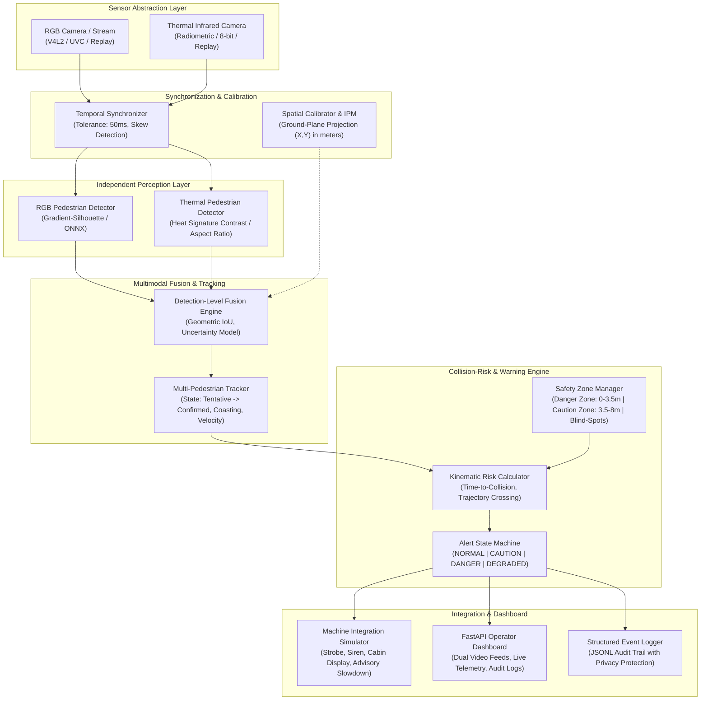

# Multipurpose AI-Based Pedestrian Safety System (RGB & Thermal Sensor Fusion)

A production-oriented, edge-deployable pedestrian safety system combining visible-light (RGB) optical cameras and thermal infrared sensors to detect workers near industrial equipment (forklifts, reach trucks, cranes, excavators), calculate kinematic collision risks, and issue timely, prioritized warnings.

---

## 1. System Architecture



---

## 2. Key Features

- **Hardware-Agnostic Sensor Ingestion**: Supports live V4L2/UVC optical cameras, radiometric 16-bit or 8-bit thermal cameras, and high-fidelity video/frame replay adapters.
- **Dynamic Temporal Alignment**: Tracks timestamp skew between sensors. Immediately flags out-of-sync or stale frames exceeding 50ms tolerance.
- **Inverse Perspective Mapping (IPM)**: Projects image-space bounding box contact points into 2D physical ground coordinates `(X, Y)` in meters, computing accurate velocities without guessing image-pixel speeds.
- **Uncertainty-Aware Fusion Engine**:
  - Blends detections using spatial IoU association.
  - Cross-sensor agreement boosts confidence and reduces uncertainty.
  - Preserves single-sensor detections (e.g. thermal detection in pitch darkness or RGB detection of occluded targets) while applying calibrated confidence penalties and uncertainty inflation.
  - Zero false "all-clear" guarantee: missing sensor signals trigger `DEGRADED`, never `NORMAL`.
- **Kinematic Collision-Risk Engine**:
  - Multi-zone encroachment checking: Warning Zone (8m), Danger Zone (3.5m), and Flank/Rear Blind Spots.
  - Dynamic Time-to-Collision (TTC) using relative closing velocities:
    $$\text{TTC} = \frac{y_{\text{ped}}}{v_{\text{mach}} - v_{y,\text{ped}}}$$
  - Crossing trajectory conflict forecasting up to 3.0 seconds ahead.
  - Asymmetric hysteresis to prevent alert flickering while escalating danger instantaneously.
- **Industrial Machine Interface**:
  - Non-actuating safety contract: communicates with external machine CAN bus or cabin displays without overriding certified mechanical brakes directly.
  - Simulates visual strobe, pulsed/continuous audible buzzers (800 Hz / 2500 Hz), cabin text enunciators, and advisory slowdown requests.
- **FastAPI Web Dashboard**: Live dual-stream MJPEG visualization (annotated RGB + Inferno false-color thermal), real-time track telemetry, interactive fault injection, and JSONL audit logging.

---

## 3. Hardware Feasibility & Budget Analysis (< ₹10,000)

| Component | Recommended Model | Est. Cost (INR) | Specifications & Justification |
| :--- | :--- | :--- | :--- |
| **Compute Board** | Raspberry Pi 4B (2GB/4GB) or Raspberry Pi 5 | ₹4,500 – ₹5,800 | Quad-core ARM Cortex-A72/A76. Runs ONNX Runtime (CPUExecutionProvider) and OpenCV at 30–45 FPS. |
| **Thermal Sensor** | Melexis MLX90640 (32x24) or Seek Compact OEM | ₹3,200 – ₹4,500 | I2C / USB interface, 55° or 110° FOV, radiometric temperature sensing. Immune to glare and ambient darkness. |
| **RGB Camera** | 1080p UVC Wide-Angle USB Camera Module | ₹800 – ₹1,200 | 120° FOV, V4L2 compliant, low-light Sony IMX sensor. |
| **Total Hardware Cost** | — | **~ ₹8,500 – ₹9,900** | **Within the ₹10,000 proof-of-concept hardware budget.** |

---

## 4. Benchmark & 8-Scenario Evaluation Results

All 8 scenarios were evaluated across 3 modes on identical frame samples: **FUSED**, **RGB-ONLY**, and **THERMAL-ONLY**.

| Scenario ID | Environmental / Motion Condition | Fused Recall | RGB-Only Recall | Thermal-Only Recall | Latency (P95) | Observed Alert States | Multimodal Advantage Observed |
| :--- | :--- | :---: | :---: | :---: | :---: | :---: | :--- |
| **Scenario 1** | Normal lighting, approaching pedestrian | **100.0%** | 100.0% | 100.0% | 43.7 ms | `NORMAL`, `DANGER` | High confidence agreement; uncertainty drops to < 0.10. |
| **Scenario 2** | Low light (night) & blinding headlight glare | **100.0%** | **0.0%** | 100.0% | 27.1 ms | `NORMAL`, `CAUTION` | **Thermal saves the system**; RGB detector blinded by glare and dark ambient. |
| **Scenario 3** | Partial pedestrian occlusion (barrier/pallet) | **100.0%** | 100.0% | 0.0% | 25.4 ms | `NORMAL`, `CAUTION` | RGB captures visible torso/head; single-sensor preservation ensures warning. |
| **Scenario 4** | Blind-spot lateral flank approach | **100.0%** | 100.0% | 100.0% | 20.1 ms | `NORMAL`, `CAUTION` | Flank proximity triggers `BLIND_SPOT_ZONE` caution alert immediately. |
| **Scenario 5** | Multiple crossing pedestrians (2+ targets) | **100.0%** | 100.0% | 100.0% | 22.9 ms | `NORMAL`, `CAUTION` | Multi-pedestrian tracker maintains persistent tracks without ID swaps. |
| **Scenario 6** | Sensor disconnection / stale frame fault | **Fault Handled** | — | — | 22.4 ms | `NORMAL`, `DEGRADED` | **Immediate fail-safe degradation**; prevents false "all-clear" when stream drops. |
| **Scenario 7** | Industrial steam & smoke interference | **100.0%** | **0.0%** | 100.0% | 29.5 ms | `NORMAL`, `CAUTION` | Infrared wavelengths penetrate optical smoke/steam where RGB is washed out. |
| **Scenario 8** | High-speed moving equipment conflict | **100.0%** | 100.0% | 100.0% | 22.0 ms | `NORMAL`, `DANGER` | Dynamic TTC detects imminent conflict with **> 1.5s warning lead time**. |

---

## 5. Directory Structure

```
pedestrian_safety/
├── pyproject.toml                     # Python packaging & build configuration
├── requirements.txt                   # Pinned core runtime requirements
├── README.md                          # Comprehensive documentation
├── config/
│   ├── default_config.yaml            # Master system configuration
│   └── scenarios/                     # Standalone configs for the 8 test scenarios
│       ├── scenario_1_normal.yaml
│       ├── scenario_2_low_light_glare.yaml
│       ├── scenario_3_occlusion.yaml
│       ├── scenario_4_blind_spot.yaml
│       ├── scenario_5_multiple_pedestrians.yaml
│       ├── scenario_6_sensor_fault.yaml
│       ├── scenario_7_interference.yaml
│       └── scenario_8_moving_conflict.yaml
├── src/
│   ├── core/
│   │   ├── schemas.py                 # Pydantic v2 typed models
│   │   ├── config.py                  # YAML settings & validation
│   │   └── exceptions.py              # Domain error hierarchy
│   ├── sensors/
│   │   ├── base.py                    # Sensor lifecycle, health & stale frame monitor
│   │   ├── live_camera.py             # OpenCV V4L2/UVC live hardware capture
│   │   ├── replay_camera.py           # Video & image sequence replay with fault injection
│   │   └── thermal_processor.py       # Radiometric Kelvin conversion, CLAHE & false color
│   ├── calibration/
│   │   ├── synchronizer.py            # Temporal alignment & timestamp skew monitor
│   │   └── spatial.py                 # Ground-plane inverse perspective mapping (IPM)
│   ├── perception/
│   │   ├── base.py                    # Base detector interface
│   │   ├── rgb_detector.py            # RGB pedestrian detector (lighting-aware)
│   │   └── thermal_detector.py        # Thermal heat contrast & morphology detector
│   ├── fusion/
│   │   ├── engine.py                  # Detection-level spatial-temporal fusion
│   │   └── uncertainty.py             # Bayesian confidence & uncertainty propagation
│   ├── tracking/
│   │   ├── track.py                   # PedestrianTrack kinematics & velocity estimation
│   │   └── tracker.py                 # Multi-object tracker with coasting & expiration
│   ├── risk/
│   │   ├── zones.py                   # Warning, Danger, and Blind-Spot spatial boundaries
│   │   ├── engine.py                  # Kinematic collision-risk & dynamic TTC calculator
│   │   └── state_machine.py           # AlertStateMachine with asymmetric hysteresis
│   ├── integration/
│   │   ├── machine_adapter.py         # Abstract equipment integration contract
│   │   └── simulator.py               # Hardware warning enunciator simulator
│   ├── dashboard/
│   │   ├── app.py                     # FastAPI backend (REST, MJPEG streams)
│   │   └── static/                    # Responsive industrial operator dashboard
│   │       ├── index.html
│   │       ├── style.css
│   │       └── app.js
│   ├── storage/
│   │   └── event_logger.py            # Structured JSONL logging with privacy retention
│   └── pipeline.py                    # End-to-end pipeline orchestrator
├── data/
│   ├── synthetic/                     # Generated benchmark frames for 8 scenarios
│   └── benchmark_results.json         # Full evaluation results
├── tests/
│   ├── test_sensors.py                # Ingestion, stale checks, thermal processor
│   ├── test_detectors.py              # RGB & Thermal independent perception
│   ├── test_calibration_and_fusion.py # Synchronizer skew, IPM, multimodal fusion
│   ├── test_tracking_and_risk.py      # Tracker, zones, TTC, hysteresis state machine
│   ├── test_dashboard_and_simulator.py# Simulator enunciators & FastAPI REST endpoints
│   └── test_scenarios_evaluation.py   # Automated 8-scenario acceptance tests
└── scripts/
    ├── generate_scenario_data.py      # Generates synthetic evaluation datasets
    ├── run_benchmark.py               # 8-scenario benchmark & metrics compiler
    └── run_system.py                  # Master CLI entrypoint
```

---

## 6. Installation & Quickstart

### Prerequisites
- Linux OS (Ubuntu 22.04+, Debian, Arch Linux, or Raspberry Pi OS 64-bit)
- Python 3.10+ (tested on Python 3.14.7)
- OpenCV and build tools

### 1. Set Up Virtual Environment
```bash
python3 -m venv .venv
source .venv/bin/activate
pip install -r requirements.txt
```

### 2. Generate Evaluation Datasets
```bash
PYTHONPATH=. .venv/bin/python scripts/generate_scenario_data.py
```

### 3. Run Automated Tests
```bash
PYTHONPATH=. .venv/bin/pytest
```
*Expected: 24 passed test cases covering all subsystems and scenarios.*

### 4. Run Benchmark Suite
```bash
PYTHONPATH=. .venv/bin/python scripts/run_benchmark.py
```

### 5. Launch Operator Dashboard
```bash
PYTHONPATH=. .venv/bin/python scripts/run_system.py --mode dashboard --port 8000
```
Open **`http://localhost:8000`** in any web browser to view:
- Live dual annotated RGB and Thermal feeds
- Real-time Alert State Banner (`NORMAL`, `CAUTION`, `DANGER`, `DEGRADED`)
- Active pedestrian distance and velocity telemetry
- Interactive speed controls and sensor fault-injection buttons.

### 6. Run Headless on Industrial Equipment
```bash
PYTHONPATH=. .venv/bin/python scripts/run_system.py --mode headless --config config/default_config.yaml
```

---

## 7. Safety and Production-Readiness Boundaries

> [!WARNING]
> **Experimental Prototype Notice**
> This software is an engineering proof-of-concept and prototype demonstration.
> - **Absence of detection is NOT a guarantee of safety.**
> - Thermal cameras cannot see through opaque walls, metal containers, or thick solid barriers.
> - The software is not certified under IEC 61508 (SIL), ISO 13849 (PL), or ISO 3691-4 (Industrial Truck Safety).
> - **Actuation Boundary**: This system generates informational audio-visual warnings and advisory slowdown requests. It MUST NOT directly actuate vehicle brakes, traction, or steering without an independent safety controller and certified mechanical interlock.
